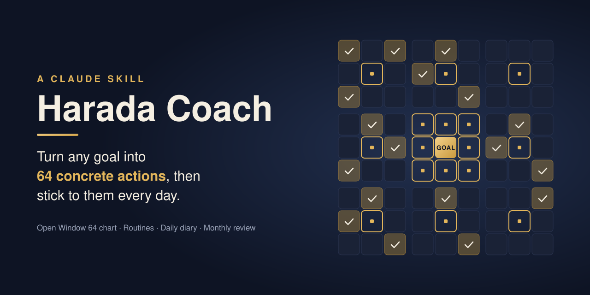

# Harada Coach



*[Version française](README.fr.md)*

A Claude skill that walks you step by step through the **Harada Method**: turn an ambitious goal into a concrete action plan, then stick to it over time with routines, a daily diary and a monthly review.

The skill doesn't fill in the forms for you. It asks one question at a time, pushes you to be specific, suggests ideas when you're stuck, then shapes your answers into ready-to-use documents.

## What it's for

- Turn a vague goal into one that is **measurable and dated**.
- Understand **why** you really want it, and what made you succeed or fail in the past.
- Anticipate obstacles before they show up.
- Break the goal down into **8 areas and 64 actions** (the Open Window 64 chart).
- Take action the very next day with 10 dated tasks and 10 routines.
- Stay on track with the daily diary and the monthly review.

It works for a personal goal (health, sport, learning, finances) as well as a professional or team goal.

## Where the method comes from

The method was created by **Takashi Harada**, a physical education teacher at a junior high school in Osaka. In a school known to be difficult, he led his students to the top national level in track and field by betting on one simple idea: teach each person to become **self-reliant**, able to set a goal and coach themselves.

He then formalized his approach and taught it to Japanese companies. Norman Bodek brought it to the West with the book *The Harada Method*.

It became famous through baseball player **Shohei Ohtani**, who filled in an Open Window 64 chart in high school, aiming to be a first-round draft pick.

> Source: Takashi Harada and Norman Bodek, *The Harada Method, 2nd Edition: The Spirit of Self-Reliance*, PCS Press, 2024. This skill rephrases the method and does not reproduce the book.

> **Unofficial project:** not affiliated with or endorsed by Takashi Harada, the Harada Education Institute or the publishers of *The Harada Method*.

## What the skill creates

A `harada/<your-goal>/` folder containing:

| Document | Purpose |
|---|---|
| `0-Dashboard.md` | Overview: goal, levels, milestones, tasks, routines, progress |
| `1-Self-assessment 33 qualities.md` | Where you stand on the 33 qualities of self-reliance |
| `2-Long-term goal form.md` | The method's full form |
| `3-Open Window 64 chart.md` | The 9×9 chart: goal in the center, 8 areas, 64 actions |
| `4-Routine check sheet - YYYY-MM.md` | The month's routines, to tick every day |
| `5-Diary/` | The daily diary |
| `6-Monthly review - template.md` | The end-of-month review outline |

Files are plain Markdown: they open in any editor and work well in Obsidian.

## Installation

### Claude Code

Clone the repository into your personal skills folder:

```bash
git clone https://github.com/ojtouch/harada-coach ~/.claude/skills/harada-coach
```

On Windows (PowerShell):

```powershell
git clone https://github.com/ojtouch/harada-coach "$env:USERPROFILE\.claude\skills\harada-coach"
```

To use it in a single project only, clone it into `.claude/skills/harada-coach` at the project root instead.

### Claude.ai or Claude Desktop

Download the repository as a ZIP (**Code** button, then **Download ZIP**), then upload it in **Settings > Capabilities > Skills**.

## Usage

Start the skill with a command, or simply by talking about your goal:

| Command | What happens |
|---|---|
| `/harada-coach` or "I have a goal" | New goal: the full session (60 to 90 minutes, can be split across several sessions) |
| `/harada-coach assessment` | Only the 33-quality self-reliance self-assessment |
| `/harada-coach diary` | Today's diary: review, routines ticked, plan for tomorrow and coach's feedback |
| `/harada-coach review` | The monthly review: routine rates, milestones, new tasks and routines |
| `/harada-coach team` | Break a shared goal down for each member of a team |

The skill answers in the language you write in.

### Steps of a "new goal" session

1. Self-reliance self-assessment (optional, recommended the first time)
2. Central goal, 4 levels and milestones
3. Daily service, at home and at work
4. Purposes and values, from 4 perspectives
5. Analysis of successes, failures and obstacles
6. The 8 areas of action
7. The 64 actions, scored by impact and effort
8. Starting plan: 10 tasks and 10 routines
9. Mindset and support
10. Tracking rituals
11. Document generation

If you stop halfway, progress is saved in the dashboard so you can pick up where you left off.

## Repository structure

```
harada-coach/
├── SKILL.md        # Coach instructions
├── references/     # Detailed method, phase by phase, and guardrails
└── templates/      # Templates for the generated documents
```

## License

MIT. See [LICENSE](LICENSE).
